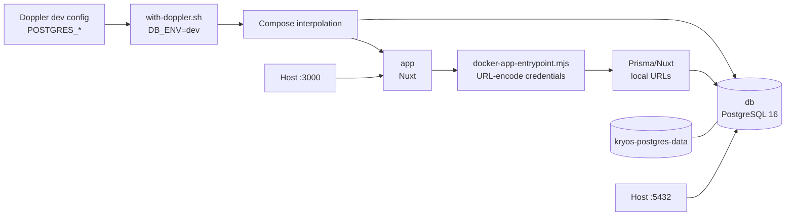

# Kryos Local Docker Setup

This guide runs the Kryos Nuxt application and a local PostgreSQL database with Docker Compose. It uses the existing Doppler project and `dev` config while keeping the local database separate from the Neon database used by host-based development.

Run these commands from the repository root on the current task branch. Inspect `git status` first and preserve existing work; see [`AGENTS.md`](../../AGENTS.md) for repository-wide agent and safety guidance.

## What this setup provides

- Nuxt development server in the `app` container when using `compose.dev.yaml`.
- Built Nuxt server in the `app` container when using only `compose.yaml`.
- PostgreSQL 16 in the `db` container.
- Persistent PostgreSQL data in a named Docker volume.
- Compose service-to-service access at `db:5432`.
- Host access at `http://localhost:3000` and, by default, `localhost:5432`.

This is local development infrastructure. It is not production infrastructure, does not seed sample devices, does not include a simulator service or message broker, and does not connect the Dockerized app to Neon.

## Prerequisites

| Tool | Purpose | Version check |
| --- | --- | --- |
| Git | Repository and branch management | `git --version` |
| Node.js | Nuxt, Prisma, and scripts | `node --version` |
| npm | Dependencies and package scripts | `npm --version` |
| Docker Engine/Desktop | Container runtime | `docker --version` |
| Docker Compose v2 | Compose operations | `docker compose version` |
| Doppler CLI | Secret/environment injection | `doppler --version` |

The Dockerfile pins Node.js `22.22.3`. `package.json` does not declare an `engines` range; use a compatible Node.js 22/npm installation for host commands.

You need access to Doppler project `kryos-defense-solutions`, config `dev`. The wrapper at `scripts/with-doppler.sh` runs:

```text
doppler run --project kryos-defense-solutions --config dev -- env DB_ENV=dev <command>
```

It injects the configured variables and explicitly sets `DB_ENV=dev`; it does not edit Doppler settings or secrets.

## Environment boundaries

| Workflow | Database target | URL variables | Boundary |
| --- | --- | --- | --- |
| Local Docker | Compose PostgreSQL at `db:5432` inside `app` | Derived from `POSTGRES_*` | Does not access Neon |
| Host development | Existing selected host database, normally Neon dev | `DATABASE_URL_DEV`, `DIRECT_URL_DEV` | Use only after verifying the target |
| Host integration tests | Local PostgreSQL at `localhost:${POSTGRES_PORT:-5432}`, logical database `kryos_test` | `TEST_DATABASE_URL`, `KRYOS_ALLOW_LOCAL_TEST_DATABASE` | Local only; never Neon/staging/production |
| Staging/production | Hosted environments | Environment-specific URL pairs | Out of scope here |

Do not overwrite `DATABASE_URL_DEV` or `DIRECT_URL_DEV` to run Docker. Compose explicitly blanks those fields in the app container, passes local `POSTGRES_DB`, `POSTGRES_USER`, and `POSTGRES_PASSWORD`, and lets `scripts/docker-app-entrypoint.mjs` derive URL-encoded local values.

Never print passwords or complete resolved URLs. Never commit `.env` files, Doppler output containing values, or logs containing connection strings.

## Doppler variables

The local Docker workflow requires:

| Variable | Purpose | Consumer |
| --- | --- | --- |
| `POSTGRES_DB` | Local database name | PostgreSQL initialization and app entrypoint |
| `POSTGRES_USER` | Local PostgreSQL role | PostgreSQL initialization and app entrypoint |
| `POSTGRES_PASSWORD` | Local role password | PostgreSQL initialization and app entrypoint |
| `DB_ENV` | Prisma/server environment selector | Set explicitly to `dev` by wrapper and entrypoint |

`POSTGRES_PORT` and `APP_PORT` are optional and default to host ports 5432 and 3000. They do not change the app's internal target of `db:5432`.

Host Prisma configuration loads `DIRECT_URL_<ENV>` through `resolveDatabaseEnvironment()`; the runtime client loads `DATABASE_URL_<ENV>`. In Docker, the entrypoint replaces the `dev` pair with local URLs before Prisma or Nuxt starts.

The Compose database named by `POSTGRES_DB` is the local development database. `kryos_test` is a separate logical database in the same local PostgreSQL instance when it is provisioned for integration tests; migrations and data in one database do not apply to the other.

The integration-test guard in [`tests/local-test-database.ts`](../../tests/local-test-database.ts) requires `TEST_DATABASE_URL` to use PostgreSQL, target `localhost`, `127.0.0.1`, or `::1`, and name the database `kryos_test`, plus `KRYOS_ALLOW_LOCAL_TEST_DATABASE=true`. A missing URL intentionally skips the guarded suite; an unsafe supplied URL is rejected before database access. Report skipped tests separately and never count them as passing integration coverage.

### Verify access without displaying values

List names only:

```bash
doppler secrets \
  --project kryos-defense-solutions \
  --config dev \
  --only-names \
  | sort
```

Check only the required local names:

```bash
doppler secrets \
  --project kryos-defense-solutions \
  --config dev \
  --only-names \
  | rg 'POSTGRES_(DB|USER|PASSWORD)'
```

`DB_ENV=dev` is supplied by the wrapper and need not be stored as a secret.

## First-time setup

### 1. Confirm branch and directory

```bash
pwd
git branch --show-current
```

Confirm the path is the repository root and inspect the current branch. Preserve existing work before switching branches or changing files.

### 2. Validate Doppler and Compose

Confirm Doppler access using the names-only command above, then validate Compose through the wrapper:

```bash
npm run doppler -- docker compose -f compose.yaml -f compose.dev.yaml config --quiet
```

This resolves required interpolation variables and validates the model without printing the resolved configuration.

For an additional secret-free assertion that Neon URLs cannot override local Docker URLs:

```bash
config_file="$(mktemp)"
trap 'rm -f "$config_file"' EXIT
bash scripts/with-doppler.sh docker compose -f compose.yaml -f compose.dev.yaml config --format json >"$config_file"
CONFIG_FILE="$config_file" node --input-type=module <<'NODE'
import fs from "node:fs";

const config = JSON.parse(fs.readFileSync(process.env.CONFIG_FILE, "utf8"));
const environment = config.services.app.environment;

if (
  environment.DB_ENV !== "dev" ||
  environment.DATABASE_URL_DEV !== "" ||
  environment.DIRECT_URL_DEV !== ""
) {
  throw new Error("Compose is not configured for local URL derivation.");
}

console.log("Compose local URL override check passed.");
NODE
```

The temporary JSON contains resolved environment data. Do not display or commit it; the trap removes it when the shell exits.

### 3. Build and start

```bash
npm run docker:doppler-up
npm run docker:doppler-ps
```

Wait until `db` reports `healthy` and `app` reports `running`. Compose waits for the PostgreSQL health check before starting the app.

The development override mounts the repository into the app, keeps `node_modules`, `.nuxt`, and generated Prisma output in container-owned volumes, and enables polling-based file watching. Source edits therefore reload without rebuilding the image. Changes to `package.json`, `package-lock.json`, the Dockerfile, or other image inputs require `--build`.

### Production-style container check

The base Compose file runs the built Nuxt server from `.output/server/index.mjs` and does not mount the host source tree. Use it to validate the production-style image:

```bash
npm run doppler -- docker compose up --build -d
npm run doppler -- docker compose ps
npm run doppler -- docker compose run --rm app npx prisma migrate deploy
```

This mode does not hot reload. Rebuild after source or dependency changes, then recreate the app container. Use the two-file command above for daily development.

### 4. Apply migrations

```bash
npm run docker:doppler-migrate
```

This applies the committed migrations under `prisma/migrations` to the local development database named by `POSTGRES_DB`; it does not create a new migration. The four current migrations are:

- `20261010000000_create_devices`: creates `devices` and its base constraints.
- `20261015000000_add_device_operational_state`: adds health, availability, charging, assignment, fault, message, run, and sequence projection fields and constraints.
- `20261015010000_add_simulator_run_authority`: adds the generation allocator, `simulator_runs`, device authority fields, constraints, and the authority index.
- `20261016000000_add_telemetry_occurred_at`: adds `devices.last_telemetry_occurred_at` for producer event time.

This development-database command does not migrate `kryos_test`. Verify the effective datasource before any migration command.

### Local PostgreSQL integration tests

The guarded integration suite uses a separate logical database named `kryos_test`. It may live in the same local PostgreSQL instance as the Compose development database, but it must not share that database's data. Provision `kryos_test` only inside the existing local PostgreSQL service if it is absent; never drop or recreate `POSTGRES_DB`, reset the instance, or delete the named volume.

Use a temporary shell environment for the test database. The URL must target local `localhost`, `127.0.0.1`, or `::1` and the database name must be exactly `kryos_test`; do not print or persist the URL:

```bash
export TEST_DATABASE_URL='<local PostgreSQL URL targeting kryos_test>'
export KRYOS_ALLOW_LOCAL_TEST_DATABASE=true
```

Before applying migrations, point both Prisma URLs at that same temporary local target and run migration status. Confirm the output names `kryos_test` and the local host, then deploy the committed migrations:

```bash
DB_ENV=dev DATABASE_URL_DEV="$TEST_DATABASE_URL" DIRECT_URL_DEV="$TEST_DATABASE_URL" npx prisma migrate status
DB_ENV=dev DATABASE_URL_DEV="$TEST_DATABASE_URL" DIRECT_URL_DEV="$TEST_DATABASE_URL" npx prisma migrate deploy
```

Run the guarded integration file without resetting or deleting data:

```bash
npm test -- tests/telemetry-persistence.integration.test.ts
```

If `TEST_DATABASE_URL` is missing, the integration tests intentionally skip. If it is supplied but lacks the explicit opt-in or fails the local-host/database-name checks, test collection fails before database access. Report skipped tests separately from passed tests.

### 5. Verify services

```bash
npm run docker:doppler-ps
npm run doppler -- docker compose -f compose.yaml -f compose.dev.yaml exec -T db pg_isready
curl --silent --show-error --output /dev/null --write-out '%{http_code}\n' http://127.0.0.1:3000
curl --silent --show-error --output /dev/null --write-out '%{http_code}\n' http://127.0.0.1:3000/api/fleet
```

Expected HTTP results are `200`. A newly created local database has no seeded devices, so an empty fleet collection is expected and is not an API failure.

To inspect the effective target without printing passwords:

```bash
npm run doppler -- docker compose -f compose.yaml -f compose.dev.yaml run --rm app node --input-type=module -e '
const fields = (value) => {
  const url = new URL(value);
  return {
    protocol: url.protocol,
    hostname: url.hostname,
    port: url.port,
    database: url.pathname.slice(1),
    user: decodeURIComponent(url.username),
    passwordPresent: Boolean(url.password),
  };
};
console.log(JSON.stringify({
  DB_ENV: process.env.DB_ENV,
  DATABASE_URL_DEV: fields(process.env.DATABASE_URL_DEV),
  DIRECT_URL_DEV: fields(process.env.DIRECT_URL_DEV),
}));
'
```

Expected fields include `DB_ENV=dev`, hostname `db`, port `5432`, and boolean password indicators. The command does not print password values.

### 6. Open the app

Open [http://localhost:3000](http://localhost:3000).

## Architecture



The app and database share a Compose network. From inside `app`, `localhost` means the app container, not PostgreSQL; therefore the app must use `db:5432`. Host mappings only expose services to host tools.

The app depends on PostgreSQL health, but health checks do not apply migrations. PostgreSQL data persists in the named volume `kryos-defense-solutions_kryos-postgres-data` under the default project name.

The guarded development seed workflow targets the separate Neon development database and is not available inside this local Compose setup. For a seeded host-development database, run the simulator with explicit existing IDs, for example:

```bash
DB_ENV=dev SIMULATOR_TARGET_DEVICE_IDS=DEV-MK-01,DEV-EX-01 npm run simulator:run
```

The simulator otherwise generates `SIM-0001`-style IDs. If a configured target is absent, registration fails before telemetry starts with an actionable target-identity error. Do not use the seeded Neon command against the local Docker database or alter database volumes to make the identities match.

Compose passes local `POSTGRES_*` values and blanks `DATABASE_URL_DEV`/`DIRECT_URL_DEV`. The entrypoint sets `DB_ENV=dev`, assigns credentials through Node's URL API so special characters are encoded safely, sets both local URLs, and starts Nuxt or Prisma. The Dockerfile's build-time URLs are dummy values used only for `prisma generate`; they are not runtime connections.

## Daily workflow

Start or restart:

```bash
npm run docker:doppler-up
```

Status and logs:

```bash
npm run docker:doppler-ps
npm run docker:doppler-logs
npm run doppler -- docker compose -f compose.yaml -f compose.dev.yaml logs -f db
```

Run local Prisma commands through the app entrypoint:

```bash
npm run doppler -- docker compose -f compose.yaml -f compose.dev.yaml run --rm app npx prisma migrate status
npm run docker:doppler-migrate
```

Stop while preserving data:

```bash
npm run docker:doppler-stop
```

After a reboot, run the normal `up` command again. Do not use host-side Neon commands when intending to modify local PostgreSQL.

## Troubleshooting

### Doppler authentication or missing variables

Run:

```bash
doppler --version
doppler secrets --project kryos-defense-solutions --config dev --only-names | sort
```

Required local names are `POSTGRES_DB`, `POSTGRES_USER`, and `POSTGRES_PASSWORD`. Do not print values or replace missing values with hardcoded credentials.

### Compose interpolation errors

```bash
npm run doppler -- docker compose -f compose.yaml -f compose.dev.yaml config --quiet
```

The three `POSTGRES_*` variables are required. `POSTGRES_PORT` and `APP_PORT` default to 5432 and 3000. Do not use Neon URL variables to satisfy local Compose inputs.

### PostgreSQL health failures

```bash
npm run doppler -- docker compose -f compose.yaml -f compose.dev.yaml ps
npm run doppler -- docker compose -f compose.yaml -f compose.dev.yaml logs --tail=100 db
npm run doppler -- docker compose -f compose.yaml -f compose.dev.yaml exec -T db pg_isready
```

Check for a host port conflict. Change `POSTGRES_PORT` if host port 5432 is occupied; the internal target remains `db:5432`.

### Prisma P1000 authentication failures

First run the sanitized target check. It must show `db:5432`, not a Neon host. If the target is correct, the persistent volume may have been initialized with a different password. PostgreSQL does not rewrite an existing role password when `POSTGRES_PASSWORD` changes.

Preserve data with an authorized credential repair or backup/restore. If local data is disposable, explicitly confirm that fact, verify the exact volume, and remove only that volume before recreating the stack. Never reset Neon, staging, or production.

### Migration failures

Confirm PostgreSQL health, then rerun:

```bash
npm run doppler -- docker compose -f compose.yaml -f compose.dev.yaml run --rm app npx prisma migrate deploy
```

Do not use `prisma migrate dev` as a substitute for this startup flow or edit migrations to resolve an environment problem.

### App startup failures

```bash
npm run doppler -- docker compose -f compose.yaml -f compose.dev.yaml logs --tail=100 app
```

The entrypoint names missing variables without printing values. Check Doppler access and the three local `POSTGRES_*` variables.

### Port conflicts

Defaults are host ports 3000 and 5432. Set `APP_PORT` or `POSTGRES_PORT` in the Doppler config if occupied. Do not change the internal database target.

### Empty fleet

The repository does not seed local Compose PostgreSQL. After migration, an empty device collection is expected. The guarded `db:seed:dev` command targets the Neon development database and must not be used for local Compose data.

## Safe cleanup and complete reset

Routine stop:

```bash
npm run doppler -- docker compose -f compose.yaml -f compose.dev.yaml stop
```

Find the exact PostgreSQL volume:

```bash
docker volume ls \
  --filter label=com.docker.compose.project=kryos-defense-solutions \
  --format '{{.Name}}' \
  | rg 'kryos-postgres-data$'
```

With the default project name, the expected result is:

```text
kryos-defense-solutions_kryos-postgres-data
```

The following is destructive to local PostgreSQL data. Run it only after explicit confirmation that the data is disposable:

```bash
npm run doppler -- docker compose -f compose.yaml -f compose.dev.yaml down
docker volume rm kryos-defense-solutions_kryos-postgres-data
npm run doppler -- docker compose -f compose.yaml -f compose.dev.yaml up --build -d
npm run doppler -- docker compose -f compose.yaml -f compose.dev.yaml run --rm app npx prisma migrate deploy
```

The first command preserves volumes; the explicit `docker volume rm` removes only the verified PostgreSQL volume. Do not use `docker compose down -v` for routine cleanup, because it removes all named volumes in this project. Never use `docker volume prune`, broad volume deletion, or any reset command against Neon, staging, or production.

## Host-based development reference

`.env.sample` documents variable names for the existing host workflow and remains a reference. It is not required for Doppler-backed Docker development; do not copy it to `.env` as the normal Docker setup.

For host development, `npm run dev:doppler` starts Nuxt with Doppler and `DB_ENV=dev`. In that workflow the host process uses the existing `DATABASE_URL_DEV` and `DIRECT_URL_DEV` values. Verify the target before database commands and treat those values as sensitive.

The local Docker workflow keeps those Neon values untouched, uses the Compose PostgreSQL service, and derives local URLs inside the app container.
